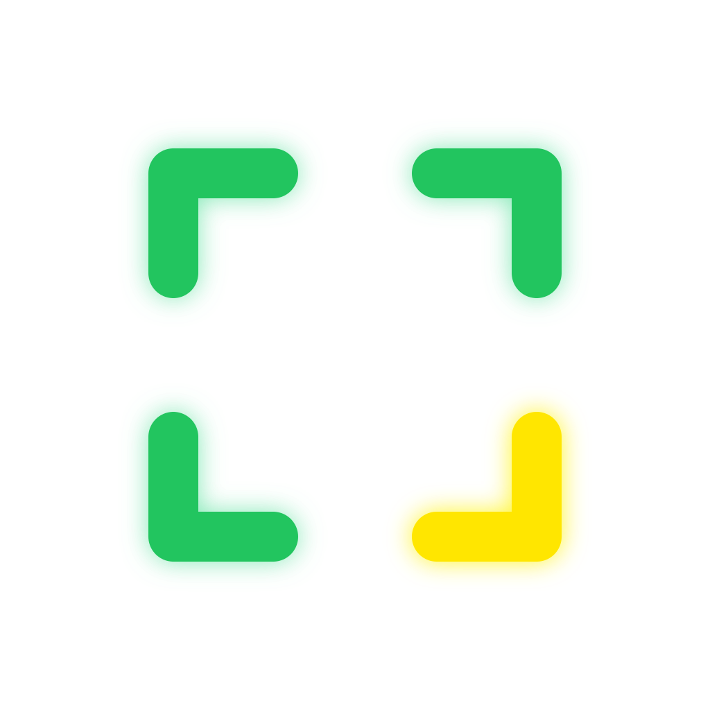

<h1 align="center">Otter</h1>

<strong>Capture it. Pin it. Make it yours.</strong> Connect nodes. Create effects. Turn your desktop into a creative workspace.

  <a href="https://github.com/aiaimimi0920/Otter/releases">Download</a> ·
  <a href="./docs/README.md">Documentation</a> ·
  <a href="https://github.com/aiaimimi0920/Otter/issues">Feedback</a>

  
  
  

English · <a href="./README.zh-CN.md">Simplified Chinese</a>

Otter is a free, open-source screenshot tool that brings capturing, annotating,
organizing and sharing into your everyday work. Turn your desktop into a workbench:
connect different processing nodes to combine functions, create effects and
explore more possibilities for the images you capture.

[Features](#features) · [Get started](#get-started) · [Contribute](#contributing)

## Features

- **Capture the view you want.** Take region, window and scrolling screenshots, and pick colors from the screen.
- **Pin images to your desktop.** Keep references in view and organize your material with groups, the library and history.
- **Annotate freely and keep editing.** Crop, erase and rotate; add text, arrows and shapes; hide information with blur and mosaic.
- **Keep pinned images live.** Turn a window or part of the screen into a live pinned view to follow changing content and interact with supported source windows.
- **Connect nodes and combine effects.** Use Loom's OCR, translation and Art capabilities, connecting nodes to build your own processing flows.
- **Project your view to other devices.** Send images or live views to connected, paired devices for viewing and collaboration across screens.

[**Features and shortcuts →**](./docs/FEATURES.md)

## Get started

| Start here | What you need to do |
| --- | --- |
| [Public downloads](https://github.com/aiaimimi0920/Otter/releases) | Follow the selected release's instructions. Current native builds are unsigned internal ZIPs; extract the entire package and keep `otter-native.exe` with `otter_live_hover_hook.dll`. See the [build guide](docs/development/WINDOWS_NATIVE_BUILD.md). |
| Use with Loom | Start Loom and install the required OCR, translation or Art capabilities, then [connect and authorize Otter](docs/features/LOOM_CONNECTION.md). |

1. Press **`Ctrl+1`** for a region screenshot, **`Ctrl+2`** for live capture, or **`Ctrl+3`** for a scrolling screenshot.
2. Select the pinned image and press **`Ctrl+E`** to edit it, or **`Tab`** to expand its parameter panel.

[**Complete usage guide →**](./docs/guide/getting-started.md)

## Development and previous versions

`main` is the current Otter product. See [development and packaging](docs/development/WINDOWS_NATIVE_BUILD.md). The last WebView main is preserved at Git tag `archive/webview-main`; existing public downloads are unchanged.

## Contributing

Bug reports, translations, documentation improvements and code contributions are welcome.
Start with [wording and translation](./CONTRIBUTING.md#wording-and-translation), and explore the
[repository layout](./docs/architecture/overview.md#2-repository-layout) to understand the code structure.
Code changes follow the [engineering contribution guide](./CONTRIBUTING.md).
File placement and module ownership follow the [code organization standard](./docs/development/CODE_ORGANIZATION.md).
Search [existing issues](https://github.com/aiaimimi0920/Otter/issues) before reporting a problem.

## License

Otter-owned code is [MIT licensed](./LICENSE). Dependencies retain their own
[licenses and notices](./THIRD_PARTY_NOTICES.md).
